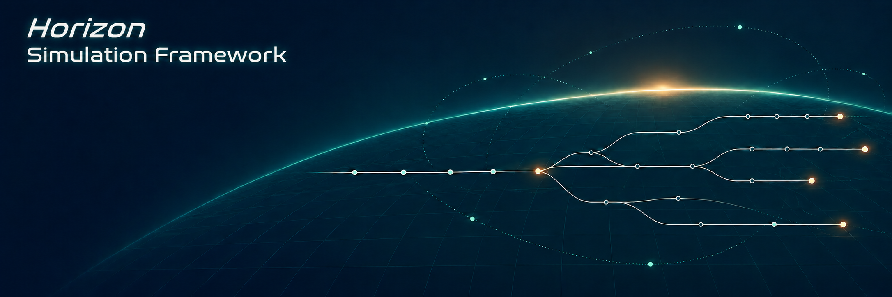
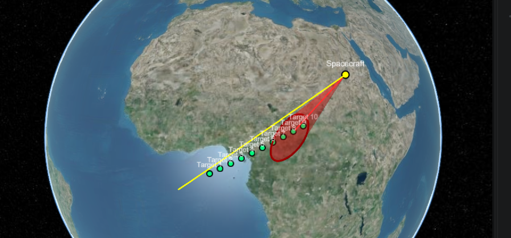

# Horizon Simulation Framework (HSF)

HSF is a simulation framework for exploring feasible task schedules for complex systems. It combines dynamic programming based optimization algorithms with a hybrid, discrete-event simulation and a user-defined system model. HSF combines an optimal scheduling algorithm based on user defined requirements and system constraints, and a dynamic system theory modeling paradigm to produce simulations of complex systems in operation.  HSF evaluates proposed tasks, checks system constraints, and tracks changes in system state over time.

## Why HSF

  

System-level requirements describe how a system must perform in use. Those requirements can be difficult to verify before the full system is operational. HSF lets a user model system behavior and evaluate candidate schedules against that model.

The framework separates schedule generation from system behavior. The scheduler proposes tasks and candidate schedules. A modular system model determines whether each task can be performed and how it changes the system state.  All elements of HSF, like tasks, schedules, and systems, are user defined to maximize flexibility and application.

## How it works

At a high level, HSF:

1. Generates candidate schedules by proposing tasks within their available access windows.
2. Evaluates each proposed task against the system model and its constraints.
3. Retains feasible schedules and scores them against user-defined objectives or requirements.

Core concepts include:

- **Asset:** the core system modeling element that simulates the motion of the system and how all states of the system change in time and in response to a proposed task.
- **Subsystem:** the modeling element that defines system capabilities and state changes.  Collections of **subsystems** form an **asset**.
- **Task:** an action for an asset to perform at a target.
- **Event:** a task together with the system state at a simulation time step.
- **Schedule:** a time-ordered collection of events including full system state data and asset information.

- **Constraint:** a condition that a subsystem or system state must satisfy - allows the user to impose system and subsystem requierments.
- **Dependency:** a defined interface through which subsystems exchange information.

## Visualization with Cesium ion

A CesiumIon-based visualization effort is underway as an important companion to HSF. The visualization project is intended to make mission scenarios and simulation results easier to explore in an interactive geospatial view. For updates on the project, check out the GitHub [HSF Cesium Viewer](https://github.com/Cal-Poly-Simulation-Lab/cesium-viewer).

## Example: Aeolus mission

The project presentation demonstrates HSF with an Earth-observing satellite scenario named Aeolus. The example models a three-revolution mission and reports target-imaging and asset-state outputs. The presentation's v3.0 target-imaging chart reports **307 hits** for that example; treat this as an illustrative result, not a general performance benchmark.

Example outputs shown include target hits, sensor on/off state, solar-panel power, battery depth of discharge, data rate, buffer fill ratio, and image pixel count.

## Example applications

The project materials identify examples involving:

- Thermal soaring
- CubeSats
- Sounding rockets
- UAV swarm search and rescue
- A 6U space telescope constellation
- Lunar Gateway trajectory analysis

## Getting started

> **Draft note:** Confirm the current supported language, dependencies, installation steps, and a runnable example before publishing this section.

1. Install the project dependencies: **[add instructions]**
2. Run the example: **[add command or notebook link]**
3. Review the generated schedules and simulation outputs: **[add output location or viewer instructions]**

## Documentation

- [Academic documentation](https://github.com/emehiel/Horizon/wiki/Academic-Documentation)
- **Cesium ion visualization documentation:** [add repository or project link]

## Project status

**Status:** **[confirm current development status and supported release]**

The material used to prepare this draft describes the framework and example scenarios but does not specify a current release, installation workflow, license, or contribution process. Add those project details before treating this README as final.

## Contributing

Contribution guidelines: **[add link or instructions]**

## License

License: **[add license name and link]**

## Citation

If you use HSF in academic work, cite: **[add preferred citation]**
